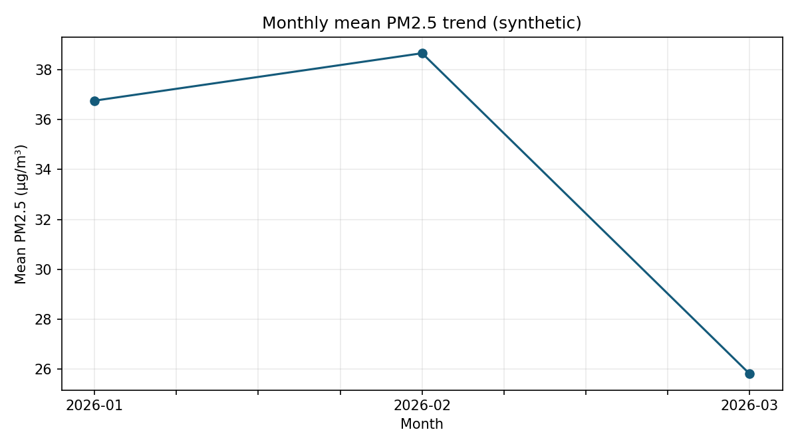
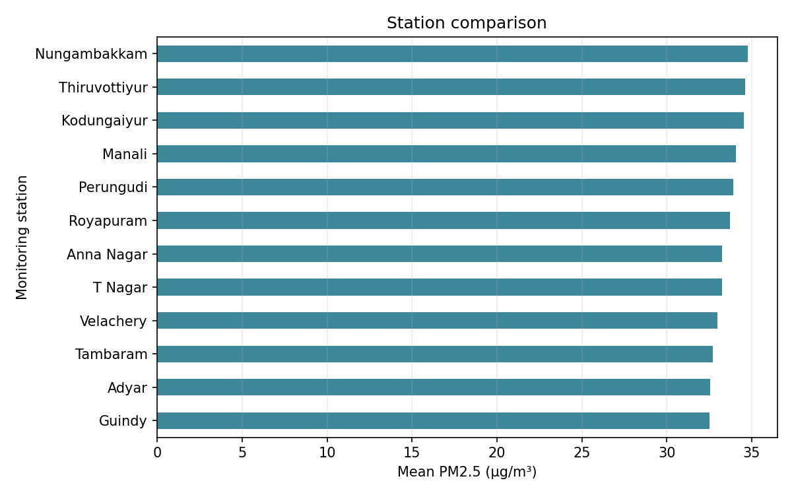
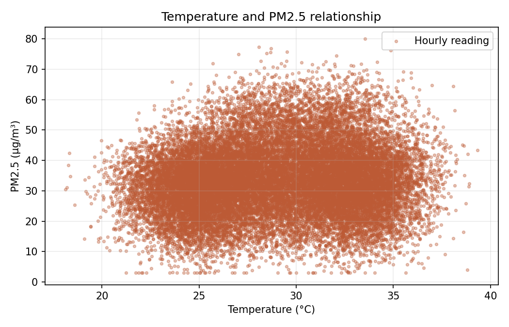
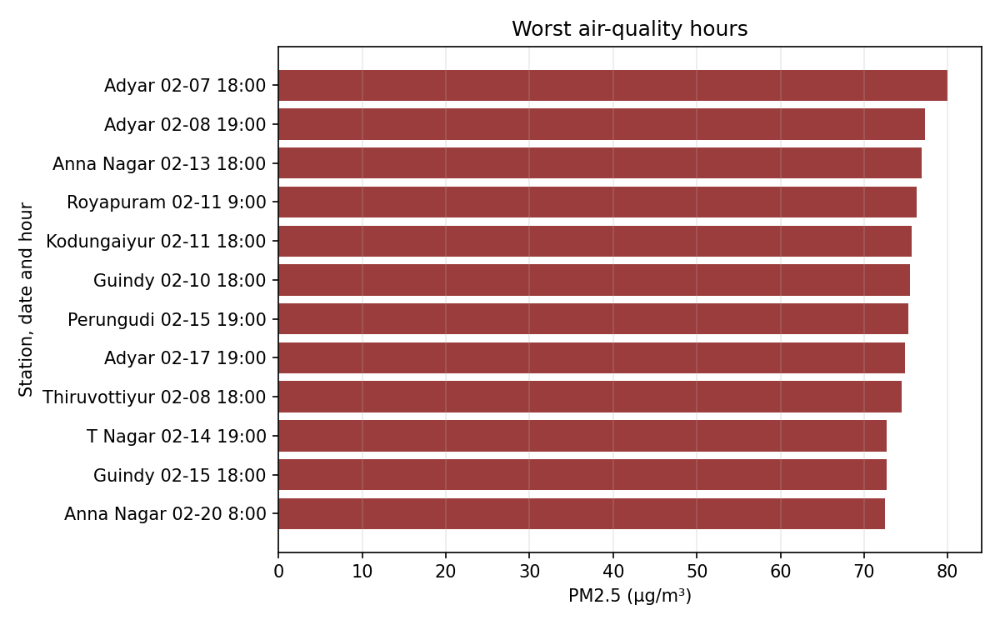

# SIMATS Python Programming Assignment 5

**Student:** P ROHIT  
**Register number:** 1925260050  
**Department:** SIMATS Engineering  
**Subject:** CSA0809 Python Programming  
**Assignment:** 5 - Data Acquisition, Cleaning, Analysis and AI Applications

This project implements the air-quality data workflow with CSV ingestion, validation and normalization, SQLite storage, four visualizations, adversarial-input handling, reproducible loop/Pandas/SQL benchmarks, profiling, sentiment scoring, extractive summarization and a rule-based database chatbot. All generated readings and complaints are synthetic; they are not observations from Chennai or any other real monitoring network.

## Run on Windows

Use Python 3.12.5 or newer. From this folder:

```powershell
python -m pip install -r requirements.txt
python main.py
python -m unittest discover -s tests -v
```

Installed versions used for the recorded measurements: Python 3.12.5, NumPy 2.4.2, Pandas 2.3.3, Matplotlib 3.10.8 and SQLite 3 via Python's standard library. `requirements.txt` pins the three external packages used by the analysis.

`main.py` creates a deterministic 12-station, 90-day, hourly synthetic dataset, a SQLite database, the four charts, actual benchmark result CSVs for 1, 12 and 100 stations (8,760 rows per station), and a cProfile report. Benchmark generation may take several minutes on a laptop because each method is repeated three times.

`run_evidence.py` saves genuine console output for the original and cleaned CSV, normalization, adversarial cases, SQL injection, query results, sentiment review, summary, chatbot, benchmark comparisons, database contents and index measurement to `outputs/reports/execution_evidence.txt`.

## Structure

| Folder | Work |
|---|---|
| `Task01_Data_Acquisition/` | Source-data design, ER/storage schema and SQL examples |
| `Task02_Cleaning_Normalisation/` | CSV validation, invalid-value handling, Fahrenheit conversion and scaling |
| `Task03_Analysis_Visualisation/` | Reproducible dataset, SQL loading, daily means and charts |
| `Task04_Debugging_Profiling/` | Debugging plan and profiling guidance |
| `Task05_AI_Applications/` | Sentiment, extractive summary, chatbot and 50 labelled synthetic complaints |
| `Task06_Cleaning_Pipeline/` | Exact assignment sample pipeline and >999 regression case |
| `Task07_Adversarial_Data/` | Missing-column, delimiter, encoding, empty-file and injection checks |
| `Task08_Loops_vs_Libraries_SQL/` | Repeated runtime/memory benchmarks and cProfile evidence |
| `Task09_Final_Engineering_Decision/` | Database strategy, query/index experiment and deployment decision |
| `tests/` | Automated regression suite |
| `outputs/charts/` | Four labeled PNG charts |
| `database/air_quality.db` | SQLite database generated by `main.py` |

## Run individual tasks

Run commands from `Assignment5/`:

```powershell
python Task03_Analysis_Visualisation/generate_data.py
python Task06_Cleaning_Pipeline/cleaning_pipeline.py
python Task07_Adversarial_Data/adversarial_tests.py
python Task08_Loops_vs_Libraries_SQL/benchmarking.py
python -m unittest discover -s tests -v
```

Tasks 1 and 4 are documented design work; their schema is in `Task01_Data_Acquisition/schema.sql` and their debugging plan is in `Task04_Debugging_Profiling/debugging_plan.md`. Task 5 components can be imported from `Task05_AI_Applications/`; `main.py` invokes the database, charts, index check and benchmark pipeline. Each task folder has a README with its purpose.

## Charts and outputs









The additional `benchmark_comparison.png` plots measured median elapsed times. All charts represent synthetic values.

## Measurement notes

Synthetic generator seed is 1925260050. Each large benchmark uses 8,760 hourly rows per station and three repetitions; the CSV/loop, Pandas groupby and in-memory SQLite groupby outputs are checked for exact agreement to six decimals. Times in benchmark CSVs are measured on the machine executing the script and should not be treated as universal performance claims. SQLite benchmark timing includes in-memory table construction and inserts; the separate index experiment measures repeated SELECTs before and after index creation. `approx_measured_state_bytes` records a measured Pandas DataFrame footprint or the Python aggregation result object; it does not claim peak resident memory for SQLite or interpreter internals.

The baseline word-list sentiment method is interpretable but does not understand sarcasm or phrase-level context. The reported corpus agreement is calculated from the supplied 50 synthetic complaint examples and their manual labels. It is a coursework demonstration, not a validated civic-decision model.

The SQLite database contains station, reading, complaint, sentiment and daily-summary tables. Station/time uniqueness, sensor checks, foreign keys and query indexes protect data integrity and support report queries. Synthetic sample values use a deterministic generator seed; none are real-world measurements. Missing values remain null and rejected records are explained in the execution log.

## GitHub

Repository: https://github.com/rohitnew1115-prog/python-CSA0809  
Assignment folder: `Assignment5/`
