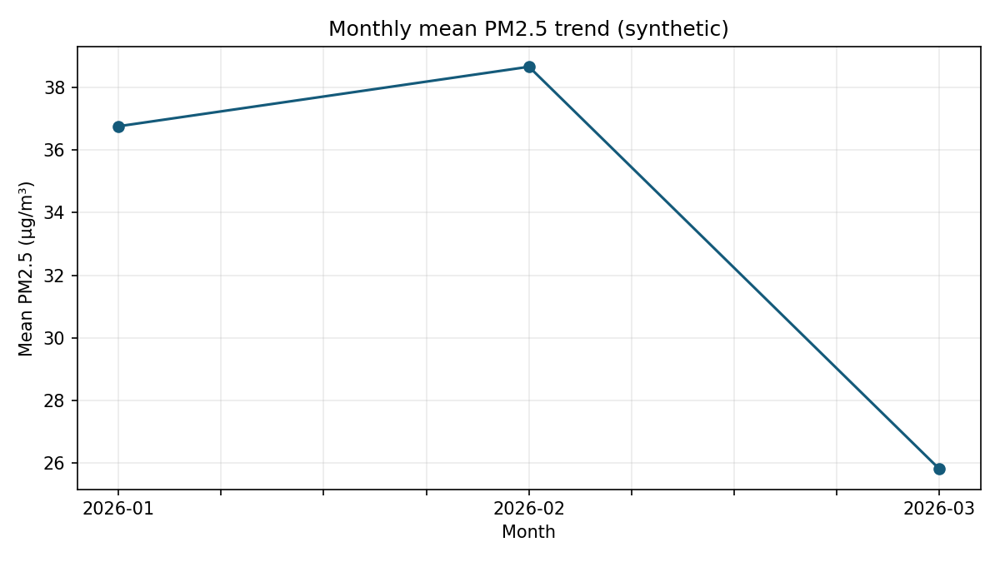
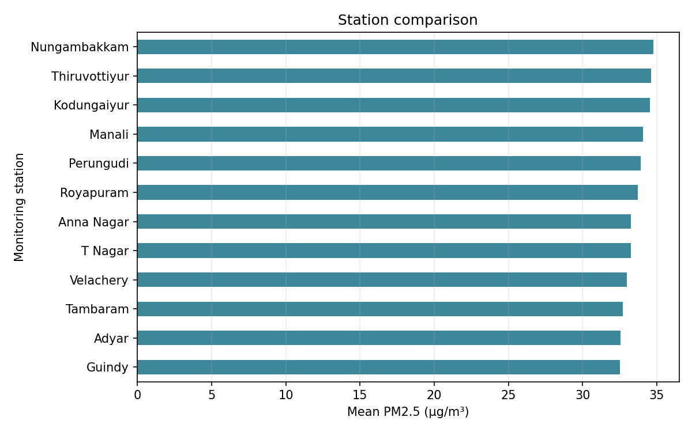
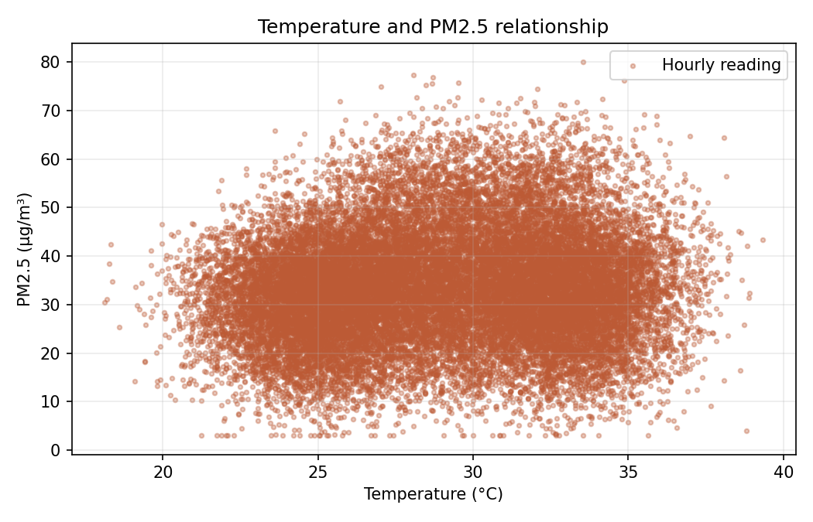
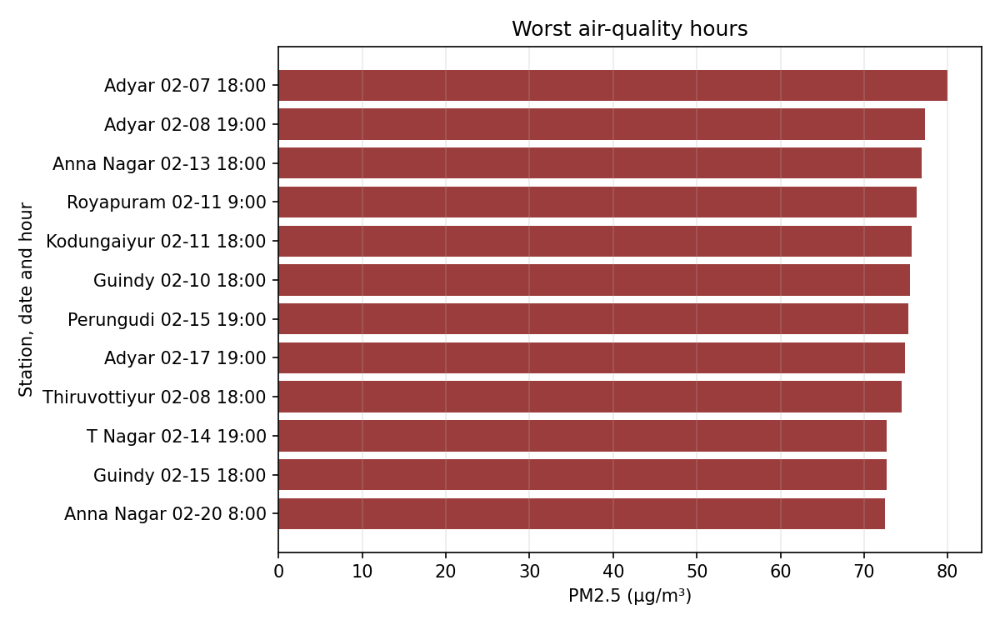

# Assignment 5 Data Acquisition Cleaning Analysis and AI Applications

## Assignment details

| Item | Details |
|---|---|
| Student name | P ROHIT |
| Register number | 1925260050 |
| Course | CSA0809 - Python Programming |
| Assignment | 5 |
| Python version | 3.12.5 |
| Main technologies | CSV, SQLite, Pandas, Matplotlib, logging, timeit and cProfile |
| GitHub repository | https://github.com/rohitnew1115-prog/python-CSA0809 |
| Repository folder | Assignment5 |

## Declaration

I submit this individual assignment in Python Programming. The programs, synthetic sample data, generated charts, database, benchmark results, tests and execution evidence are included with the submission. Generated air-quality observations and citizen complaints are simulated for coursework and are not real-world measurements.

Student: P ROHIT
Registration number: 1925260050
Signature: ______________________________  Date: ____________________

## Abstract

This report designs and implements an air-quality processing system for station CSV files and citizen complaints. It validates dates, units and sensor values, prevents duplicate station-hour records, scales values safely, stores measurements in a normalized SQLite database, answers parameterized queries and generates four required charts. Reproducible experiments compare CSV loops, Pandas groupby and SQLite GROUP BY on 8,760, 105,120 and 876,000 synthetic readings. The outputs agree; at 876,000 rows the measured median times were 7.569 s, 2.508 s and 16.640 s respectively, with SQLite timing including in-memory loading. A 50-complaint lexicon baseline agreed with manual labels on 49 cases; a targeted improvement agreed on all 50 examples. The report records the limits of these small synthetic experiments and recommends a database and human review strategy appropriate to scale.

## Part A Understanding the Assignment

### Overview

The case study combines daily station CSV acquisition with a SQLite complaint store. Each station reports hourly PM2.5, PM10, NO2, CO and temperature readings. The solution preserves provenance, records rejection reasons, converts known Fahrenheit values to Celsius, and does not silently replace missing values with zero. The implementation is organized as nine identifiable tasks, with design and pseudocode in Part A and executable implementations and evidence in Part B. Examples use P ROHIT and Muruga Dharshini only where a person name is needed.

| Task | Question | Main concepts | Program or evidence |
|---|---|---|---|
| 1 | Data acquisition design | CSV audit, normalized schema, SQL queries | `Task01_Data_Acquisition/` |
| 2 | Cleaning and normalization design | Validation, missing data, units, min-max scaling | `Task02_Cleaning_Normalisation/` |
| 3 | Analysis and visualization design | Daily aggregates and chart choices | `Task03_Analysis_Visualisation/` |
| 4 | Debugging and profiling | Assertions, logs, debugger and timers | `Task04_Debugging_Profiling/` |
| 5 | Citizen complaint AI | Sentiment, extractive summary and chatbot | `Task05_AI_Applications/` |
| 6 | Working cleaning pipeline | Exact sample, SQLite and plots | `Task06_Cleaning_Pipeline/` |
| 7 | Adversarial data | Malformed CSV and SQL injection | `Task07_Adversarial_Data/` |
| 8 | Loops, libraries and SQL | Benchmarks, memory and cProfile | `Task08_Loops_vs_Libraries_SQL/` |
| 9 | Engineering decision | Sentiment review, index and scale-up | `Task09_Final_Engineering_Decision/` |

### Environment and execution

The programs were executed with Python 3.12.5, Pandas 2.3.3, Matplotlib 3.10.8 and NumPy 2.4.2 on Windows. SQLite is provided by Python's standard library. The generated datasets use seed 1925260050. From the `Assignment5` directory, run `python main.py`, then `python run_evidence.py`, then `python -m unittest discover -s tests -v`. The benchmark runs all three methods three times for each dataset and stores measured medians.

## Part A Implementation and Analysis

### Task 1 Data Acquisition Design (7 marks)

#### 1.1 Source inspection

Each CSV has a header and one record per station and hour: station name, date, hour, PM2.5, PM10, NO2, CO, temperature and a temperature-unit marker. The natural key is station plus timestamp. Realistic controlled faults include a missing column, empty or `NA` sensor value, negative value, value outside a plausible sensor range, duplicate station-hour, unparseable date, wrong numeric type and known Fahrenheit input. These faults are represented in the synthetic fixtures, not presented as measured pollution data.

| Problem | Example | Handling |
|---|---|---|
| Missing or blank PM2.5 | `Adyar,2026-10-01,0,,70,17,.3,25,C` | Keep as missing; reject the row from PM2.5 analysis |
| NA marker | `NA` | Treat as missing, never as zero |
| Negative PM2.5 | `-5` | Reject as physically invalid |
| Impossible value | PM2.5 `1001` | Reject above the declared 999 limit |
| Duplicate | Same station and date-hour twice | Keep first occurrence; log later duplicate |
| Date format variation | `31/10/2026` | Parse explicitly, normalize to ISO date |
| Invalid format | `2026/10/01` | Reject with a row-level reason |
| Fahrenheit | `77,F` | Convert using `(F - 32) × 5 / 9`, yielding 25 °C |
| Invalid type | `pm10=high` | Reject the value and retain the reason |
| Missing columns | Missing `hour` or `co` header | Stop file processing with the missing column list |

#### 1.2 Normalized SQLite storage

The schema in `Task01_Data_Acquisition/schema.sql` separates station metadata from time-series observations. `stations.station_id` is the primary key and `station_name` is unique. `readings.reading_id` is the primary key; `station_id` is a foreign key; `(station_id, observed_at)` is unique. Sensor checks reject negative or extreme values, and the station/time indexes support the common filters. Additional tables store complaints, sentiment outputs and daily aggregates.

```text
STATIONS 1 ─────────── * READINGS
  station_id PK          reading_id PK
  station_name UNIQUE    station_id FK
  area                   observed_at, sensor values

COMPLAINTS 1 ────────── 1 SENTIMENT_RESULTS
STATIONS 1 ──────────── * DAILY_SUMMARIES
```

CSV station text maps to `stations.station_name`; its date and hour become ISO `observed_at`; pollutant values map to numeric reading columns; temperature is stored in Celsius; and `source_file` records provenance. Separating stations avoids repeating area and location data in every hourly row, allows foreign-key checks, and gives one consistent station identifier for joins.

#### 1.3 CSV or SQL

The following queries answer October station average, station comparison and worst daily mean. Each user-provided value is bound as a parameter.

```sql
SELECT AVG(r.pm25)
FROM readings r JOIN stations s USING (station_id)
WHERE s.station_name = ? AND r.observed_at >= ? AND r.observed_at < ?;

SELECT s.station_name, AVG(r.pm25)
FROM readings r JOIN stations s USING (station_id)
GROUP BY s.station_name ORDER BY AVG(r.pm25) DESC;

SELECT substr(observed_at, 1, 10) AS day, AVG(pm25) AS mean_pm25
FROM readings WHERE pm25 IS NOT NULL
GROUP BY day ORDER BY mean_pm25 DESC LIMIT 1;
```

Reading a CSV and filtering all n rows takes O(n) time for each question. A DataFrame also retains the input in memory, with storage roughly proportional to the row count and string/object representation. An indexed SQLite filter performs approximately O(log n + k) work for k matching rows; a full aggregation still examines the qualifying rows. CSV is easy to exchange and archive; SQLite adds transactions, constraints and indexes and avoids repeated parsing. SQLite is the justified choice for this small multi-query system; a CSV remains the interchange format.

### Task 2 Cleaning and Normalization Design (5 marks)

#### 2.1 Cleaning rules

The cleaning function checks required headers, nonempty station names, supported date formats and hours from 0 through 23. It parses each measurement numerically, treats blank, `NA`, `N/A` and `NULL` as missing, checks per-sensor limits, converts Fahrenheit only when the source marks the unit, rejects duplicate station timestamps and returns rejected rows with line number and reason. Missing values stay null. A row with invalid PM2.5 is omitted from PM2.5 analysis; other missing pollutant fields remain null for field-specific analysis.

#### 2.2 Normalization

Min-max scaling is `scaled = (value - minimum) / (maximum - minimum)`, rounded to three decimal places. Empty input returns an empty list. If every value is equal, the function returns 0.0 for each value so it avoids division by zero. For `[48, 95, 121]`, the result is `[0.0, 0.644, 1.0]`.

#### 2.3 Pseudocode

```text
FUNCTION clean_file(path)
  OPEN CSV with UTF-8 and DictReader
  IF a required header is missing, report the missing names and stop
  INITIALIZE accepted rows and seen station-hour keys
  FOR each row with its source line number
    PARSE station, date and hour; validate required identity and range
    PARSE each sensor value; map blank/NA to missing
    CONVERT known Fahrenheit to Celsius before checking its range
    IF PM2.5 is invalid OR key was already seen, record rejection and continue
    APPEND normalized record; remember key
  RETURN accepted rows and rejection log
```

#### Alternative and complexity

Python loops with `csv` use O(n) time and can stream with O(1) row memory plus O(g) aggregation state. Pandas `read_csv` and vectorized masks also process O(n) values but allocate DataFrame columns and temporary masks, using O(n) memory. NumPy vectorized min-max scaling is O(n) time and O(n) output memory; a loop can scale in place if an output list is not needed. Pandas is concise for exploration, while streaming loops reduce memory for ingestion.

### Task 3 Analysis and Visualization Design (5 marks)

#### 3.1 Daily summaries and charts

Daily mean is the sum of valid PM2.5 values divided by valid reading count for each station and date. The system stores count and mean in `daily_summaries`, so missing readings do not lower the mean as if they were zero. Four charts were selected for distinct questions:

| Chart | Design choice | Interpretation purpose |
|---|---|---|
| Monthly PM2.5 trend | Line with month on x-axis | Shows direction and seasonal movement over time |
| Station comparison | Horizontal bar, station-sorted | Compares average exposure and keeps long names readable |
| Temperature versus PM2.5 | Scatter plot | Shows spread and possible association without implying causation |
| Worst air-quality hours | Horizontal bars for the 12 largest readings | Identifies specific station, date and hour for follow-up |

Each plot has a title, labeled axes, units and readable values; the scatter plot includes a legend. The data spans three months so the monthly trend is visible. All values are generated from a seeded simulation and are not actual air-quality readings.

#### 3.2 SQL grouping versus Python aggregation

An in-memory dictionary can compute each group in one pass: O(n) time and O(g) memory for g station-day groups. Storing all readings and then grouping also needs O(n) retained data. SQL `GROUP BY` performs the aggregation inside the database; on a persistent indexed database it avoids reparsing and transferring full rows for repeated reports. For one small file, Python loops are straightforward; for recurring dashboards over stored data, SQL is easier to schedule and audit.

### Task 4 Debugging and Profiling Plan (4 marks)

#### 4.1 Debugging

Use a temporary print around a suspect branch, for example `print(row_number, station, pm25)`, then remove or disable it. Assertions check internal assumptions: `assert 0 <= hour < 24` and `assert key not in seen` before insertion. Configure logging with `DEBUG` during development and `WARNING` in routine use: `logger.warning("Rejected row %d: %s", line, reason)`. Set a `pdb` breakpoint at the row-validation boundary and inspect the current row and local variables. Complaint text should not be copied into operational logs.

Thousands of print calls format strings and perform console I/O, slowing runs and obscuring useful evidence. Logging supports levels and handlers, so routine runs can keep only warnings and errors. Assertions and breakpoints are development aids and can be removed or disabled in production.

#### 4.2 Profiling

Use `time.perf_counter()` around each complete stage, `timeit.repeat()` for isolated functions, and `cProfile` for cumulative function cost. The actual Task 8 profile covered the loop on 8,760 rows. It reported 0.146 seconds under profiler overhead; `loop_daily_means` was the top cumulative function at 0.146 s, and `csv.DictReader.__next__` accumulated 0.101 s. This points to per-row CSV parsing as the dominant measured sub-operation. Profiling output is written to `benchmark_results/profile_report.txt` and the binary profile file.

### Task 5 Design an AI Application for Citizen Complaints (4 marks)

#### 5.1 Word-list sentiment and extractive summary

The baseline positive lexicon contains `good`, `clean`, `fast`, `helpful`, `improved`, `excellent`, `safe` and `fixed`. The negative lexicon contains `bad`, `dirty`, `slow`, `rude`, `smoke`, `broken`, `unsafe` and `worse`. `not`, `never` and `no` reverse the next sentiment word. Positive scores map to positive, negative scores to negative, and zero to neutral. The four provided examples produce positive, negative, negative and positive as required.

The extractive summarizer splits source text into sentences, counts non-stopword terms across the text, ranks sentences by average frequency of their terms, selects the top sentences, then restores their original order. It copies original sentences and does not invent a paraphrase. It can miss context, perform poorly when sentences share common words, and may produce a summary that is not representative of every complaint.

#### 5.2 Rule-based chatbot

For “What is the PM2.5 in Adyar today?”, rules identify `PM2.5`, the station name `Adyar` and the requested metric. A whitelist selects a safe metric column; station name is passed through a `?` parameter in a latest-reading query. It returns the latest stored value with units and timestamp. Unsupported stations or metrics receive an explanatory prompt. This bot does not understand synonyms, misspellings, date phrases beyond “latest”, or multi-intent questions; its station list and metric vocabulary need maintenance.

#### Model alternative comparison

| Approach | Implementation effort | Compute and memory | Expected accuracy and fit |
|---|---|---|---|
| Word list | Low; transparent rules | Negligible; linear in words | Good baseline for frequent clear terms; weak on context and negation scope |
| Naive Bayes | Medium; needs labeled examples and evaluation | Low training and inference cost; model stores vocabulary statistics | Learns domain terms and word combinations but still has limited context |
| Pretrained language model | Higher integration and governance effort | Higher inference latency and memory; hosted use may require a paid service | Better contextual interpretation potential; must be evaluated and monitored |

For thousands of complaints, a word list is suitable for triage and explanation but not final enforcement decisions. A labeled classifier should be evaluated before use; ambiguous or safety-critical cases should remain available for human review.

## Part B Implementation and Experimental Investigation

### Task 6 Implement and Validate the Cleaning Pipeline (7 marks)

#### 6.1 Cleaned sample and normalization

The actual starter-shaped pipeline reads with `csv.DictReader`, skips missing, blank, `NA`, invalid, negative and above-999 PM2.5 values, and converts valid values to float. The sample output was:

```text
Cleaned records:
[('Adyar', '2026-10-01', 48.0),
 ('Guindy', '2026-10-01', 95.0),
 ('Guindy', '2026-10-03', 121.0)]
Normalised values: [0.0, 0.644, 1.0]
Above-999 test: passed
```

The nine-row multi-sensor fixture yielded three accepted records. Blank and `NA` PM2.5, negative and extreme values, a duplicate station-hour and an unsupported date were reported with line numbers. The accepted fixture is saved to `outputs/cleaned_data/cleaned_sample.csv`; input, normalized output and rejection evidence are also in `outputs/reports/execution_evidence.txt`.

#### 6.2 Comparison with design

The design proposed validation of every sensor and unit. The implementation preserves a row when PM2.5 is valid even if a secondary pollutant is absent, keeping that secondary field null; this allows analysis of valid PM2.5 without inventing values. Temperature is converted before range checking. The pipeline treats a duplicate timestamp as a rejected later row, retaining the first record deterministically.

#### 6.3 SQLite insertion and queries

The loader inserts readings with `executemany` and bound placeholders. On the provided four-record sample, October Adyar mean was `54.0`; station means were Adyar `54.0` and Guindy `108.0`; the highest sampled daily mean was `121.0` on 2026-10-03. The station average function returned `None` for `Adyar' OR '1'='1`. The malicious string is treated as a station value and matches no row; it cannot alter the SQL expression. String concatenation could change a `WHERE` clause and expose all stations.

#### 6.4 Four generated plots

| Plot | Observed synthetic pattern |
|---|---|
| Monthly trend | Monthly means vary across the generated January-March period; the line makes the seeded seasonal movement visible. |
| Station comparison | Station means differ slightly because a deterministic station offset is part of the generator. |
| Temperature and PM2.5 | The scatter shows broad spread; the generator does not encode a causal temperature effect. |
| Worst hours | The largest generated PM2.5 values are labeled by station, date and hour for focused review. |

PNG files are saved under `outputs/charts/`. The normalization comparison with loop, Pandas and SQL has measured values at 105,120 rows and a 876,000-row run in Task 8. At about 100,000 rows, the measured CSV is 5.85 MB, the Pandas DataFrame is 17.56 MB and the aggregation output object is about 0.50 MB. At 1,000,000 rows, a linear estimate from the 876,000-row run is about 56 MB of CSV, 167 MB for the Pandas frame, roughly 4.8 MB of grouping state, 8.6 s for loops and 2.9 s for Pandas. These million-row figures are estimates, not measured results. SQL's benchmark includes loading time and should not be used as a persistent-query estimate.

## Chart figures

### Monthly PM2.5 trend


### Station comparison


### Temperature versus PM2.5


### Worst air-quality hours


### Task 7 Engineer Adversarial Data (5 marks)

#### 7.1 Malformed CSV behavior

The program was deliberately given a missing header, pipe-delimited content, UTF-16 input and an empty file. It returned safe diagnostic messages and did not crash:

| Case | Observed response |
|---|---|
| Missing columns | `ERROR: missing required columns: co, hour, no2, pm10, temperature, temperature_unit` |
| Wrong delimiter | `ERROR: unable to detect CSV delimiter` |
| UTF-16 against UTF-8 reader | `ERROR: unsupported encoding (UnicodeDecodeError)` |
| Empty file | `ERROR: empty file` |

These are distinct failures: schema mismatch, delimiter detection, decoding and absence of content. The caller can route each to a correction queue with its input filename.

#### 7.2 SQL injection

One `executemany` call inserts the four assignment readings using `?` placeholders. The average function uses `WHERE station_name = ?`. Results were 54.0, 108.0 and `None` for the malicious Adyar string. Parameter binding separates SQL code from data. It also avoids quoting errors and keeps query planning consistent; it does not materially affect performance for these tiny lookups.

### Task 8 Loops versus Libraries versus SQL (8 marks)

#### 8.1 Correctness and benchmark method

Plain Python CSV loops, Pandas `groupby` and SQLite `GROUP BY` computed the same 365 daily means for the one-station sample and matched at all tested scales. The generator uses a fixed seed and exactly 8,760 hourly readings per station. Each method was timed three times with `time.perf_counter()` and the median was retained. SQLite timing includes creating and loading its in-memory table; this is deliberately stated so it is not mistaken for an indexed query against an already-loaded database. CSV bytes and aggregation/dataframe memory indicators are recorded alongside results.

#### 8.2 Measured results

| Stations | Rows | CSV loops (s) | Pandas (s) | SQLite load + GROUP BY (s) | CSV bytes | Measured state bytes: loop / Pandas / SQL |
|---:|---:|---:|---:|---:|---:|---:|
| 1 | 8,760 | 0.042298 | 0.024217 | 0.046979 | 487,471 | 47,712 / 1,463,052 / 47,712 |
| 12 | 105,120 | 0.789870 | 0.217486 | 1.117578 | 5,854,112 | 497,944 / 17,555,172 / 497,944 |
| 100 | 876,000 | 7.568970 | 2.507873 | 16.639998 | 49,066,402 | 4,230,800 / 146,292,132 / 4,230,800 |

The loop/SQL value is the returned aggregation object size, not process peak. The Pandas value is the measured deep DataFrame size. The figures show a memory trade-off: Pandas is fastest here but retains the whole frame; a streaming loop retains group state; SQL stores rows in SQLite and its measured time includes setup/inserts. All are local measurements and will vary with hardware, filesystem cache and Python/library versions. Raw benchmark inputs can be regenerated by `benchmarking.py`; the measurement CSV is retained in the repository.

#### 8.3 Profile result

The cProfile report on the 8,760-row loop recorded 61,823 calls in 0.061 profiled seconds. `loop_daily_means` consumed the most cumulative time, followed by `csv.DictReader.__next__` at 0.043 s cumulative. Parsing each CSV record is the main hot path in this implementation. `timeit.repeat()` recorded five unprofiled loop runs between 0.031539 s and 0.040172 s; cProfile instrumentation adds overhead, so its total is not directly comparable with the benchmark median.

#### 8.4 Engineering trade-off

Pandas is the fastest quick analysis path for this measured data, at the cost of a 146 MB DataFrame for 876,000 rows. A streaming loop is a good choice when memory is constrained and one pass is enough. Daily automated reporting should use a persistent SQLite database, batch ingestion and SQL aggregation; the benchmark's SQLite setup cost does not represent a preloaded production query. For the largest case, the loop took 7.569 s, Pandas 2.508 s, and SQLite including load 16.640 s. The one-pass loop and SQL aggregation both use O(n) time and O(g) working/group memory; keeping the complete input in Pandas is O(n) memory.

### Task 9 Final Engineering Decision (5 marks)

#### 9.1 Complaint analysis, summary and review

The executable baseline was tested on 50 synthetic complaints with manually assigned reference labels. It agreed on 49/50 (98%). The known error, “No staff arrived to inspect the site,” was labeled neutral because `staff` and `arrived` are not in either sentiment list. A targeted phrase rule for “no staff”, “no response”, “no inspection” and “no service” corrected this example and achieved 50/50 (100%) on this small fixture. The improvement is not general proof of model quality; the corpus is small and synthetic.

The actual extractive summary selected three high-frequency sentences: “The road is clean and the bus was fast. The staff were not helpful. Not bad, service improved.” The first-sentence baseline returned only “The road is clean and the bus was fast.” The extractive method surfaces concerns that occur later in the combined text, with measured runtime about 0.00045 s on this 50-comment set. Its frequency score remains a heuristic and may over-select repeated language.

#### 9.2 Database index measurement

On the 25,920-row database, the median station-and-month aggregate query was 0.00012135 s before the `(station_id, observed_at)` index and 0.00011825 s after it, a measured decrease of about 2.6% across 30 repetitions. This small warm local database gives a modest effect; larger tables and selective filters can benefit more. The index occupies additional storage and adds work to each insert or update. The measurement file is `outputs/reports/index_timing.csv`.

#### 9.3 Production decision

The future stream adds 100 × 96 = 9,600 station readings per day, about 3.50 million per year, and 50,000 complaints per month, or 600,000 per year. Keep immutable source CSVs for exchange and audit; validate each batch, normalize known units, log rejections, then use batched parameterized inserts. Maintain station metadata, readings, complaint text, model results and daily aggregates in separate constrained tables. Use indexed SQL for recurring daily reports and Pandas for exploration.

SQLite is appropriate for coursework and a single-writer prototype, with batched transactions, WAL mode and archival. For multiple concurrent writers, high availability, service-level guarantees or distributed ingest, use PostgreSQL or another managed relational database. A word list is an explainable triage baseline, not a sufficient production classifier. Collect reviewed labels, evaluate a trained model, retain model/version and confidence, and keep human review for uncertain and safety-related cases.

Extractive ranking reads and tokenizes W words and scores S sentences: approximately O(W + S log S) time and O(V + S) additional state for V distinct terms and S sentences. Selecting only the first sentence takes O(W) scanning time to find the boundary and O(1) additional selection state; it is not O(1) time in input length. Ranking can capture later repeated concerns; first-sentence selection is simpler and may miss the main issue.

## Verification checklist

| Requirement | Result |
|---|---|
| Design and implementation | All five Part A tasks and four Part B tasks are documented and executed |
| Data, database and charts | 25,920 synthetic readings, 50 complaints, five SQLite tables, four required plots and benchmark chart |
| Validation, AI and delivery | Cleaning, adversarial and SQL injection evidence; 13 passing tests; cProfile; sentiment review; chatbot; root GitHub Actions workflow |
